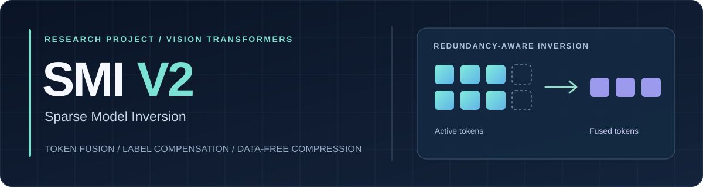
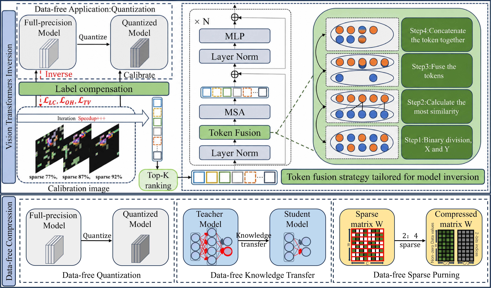
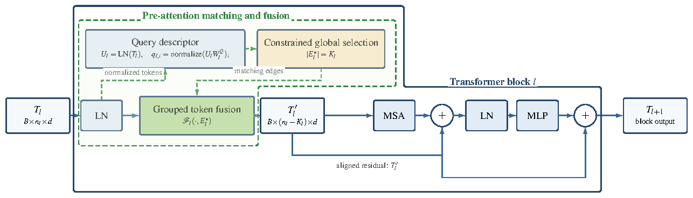
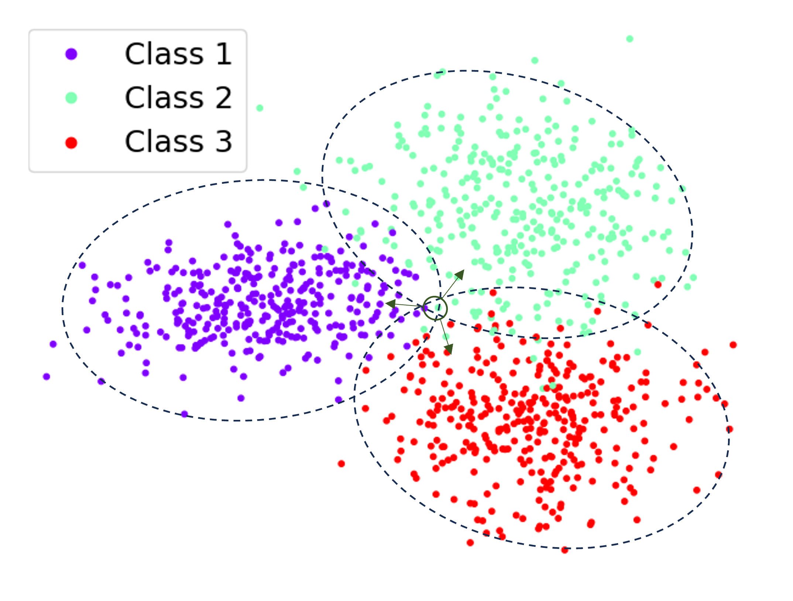
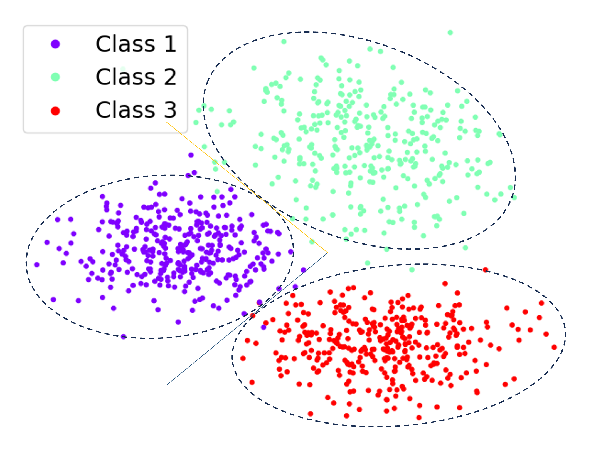
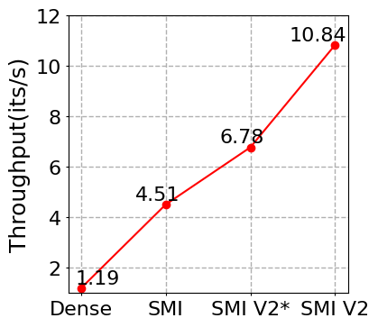
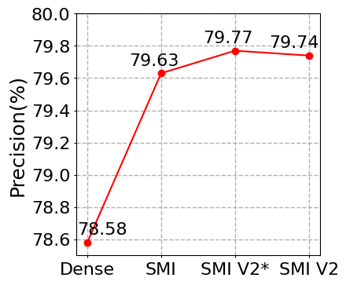
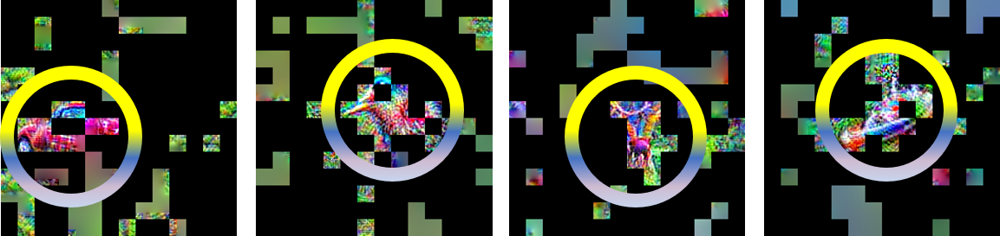
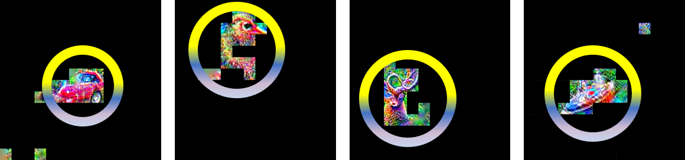

<div align="center">



<h1>Sparse Model Inversion V2</h1>

<p>Efficient inversion of Vision Transformers for data-free compression.</p>

<p><sub>Mengkui Li et al. · Research manuscript</sub></p>

<p><a href="#overview">Overview</a> · <a href="#results">Results</a> · <a href="#quick-start">Quick start</a> · <a href="#repository-guide">Repository guide</a> · <a href="#citation">Citation</a></p>

</div>

---

## At a glance

| **2.40×** | **≈81% less** | **+0.11 pp** |
| :---: | :---: | :---: |
| Inversion throughput versus SMI | Inversion FLOPs versus SMI | W8/A8 Top-1 versus SMI |

All three figures are from the manuscript's **DeiT/16-Base on ImageNet, 92% effective sparsity** experiment. They describe that operating point, not every model or task.

## Overview

SMI V2 creates surrogate images from a pretrained Vision Transformer when the original training data is unavailable. It extends [Sparse Model Inversion (SMI)](https://openreview.net/forum?id=T0lFfO8HaK), which progressively stops work on less useful image patches, with two components:

1. **Pre-attention token fusion.** It recomputes token matches as the synthetic image evolves, then fuses similar active tokens *before* self-attention. Each enabled block therefore processes a shorter sequence.
2. **Label compensation.** When a target label is supplied, a separate loss term sharpens the margin between that label and competing classes to improve the semantic alignment of inverted images.

The token-matching and weighted-aggregation principles build on [Token Merging (ToMe)](https://github.com/facebookresearch/ToMe); the contribution here is their placement and use during iterative inversion, together with the label-conditioned objective.

<p align="center">

</p>
<p align="center"><em>Overall pipeline: model inversion supplies surrogate images for three data-free compression settings.</em></p>

### Fusion happens before attention

<p align="center">
  
</p>
<p align="center"><em>Matching is updated during inversion; the attention block receives the shortened token sequence.</em></p>

### Label compensation separates features

<table>
  <tr><th align="center">SMI</th><th align="center">SMI V2</th></tr>
  <tr>
    <td width="50%"></td>
    <td width="50%"></td>
  </tr>
</table>
<p align="center"><em>Feature visualizations from the manuscript. Label compensation is used when inversion has a target label.</em></p>

## Results

### Across three compression settings

The manuscript reports the following inversion throughput for **DeiT/16-Base** at its 92% effective-sparsity point:

| Downstream setting | Dataset | SMI → SMI V2 | Speedup |
| --- | --- | ---: | ---: |
| Data-free quantization | ImageNet | 4.51 → 10.84 it/s | **2.40×** |
| Knowledge transfer | CIFAR-10 / CIFAR-100 | 5.45 → 13.47 it/s | **2.47×** |
| Sparse pruning | CIFAR-10 / CIFAR-100 | 5.41 → 13.46 it/s | **2.49×** |

### The speed and accuracy trade-off

<table>
  <tr><th align="center">Inversion throughput ↑</th><th align="center">W8/A8 Top-1 ↑</th></tr>
  <tr>
    <td width="50%"></td>
    <td width="50%"></td>
  </tr>
</table>
<p align="center"><em>DeiT/16-Base on ImageNet. SMI V2* is the 87% effective-sparsity setting; SMI V2 is the 92% setting.</em></p>

### Quantization accuracy and cost

**Data-free quantization on ImageNet, DeiT/16-Base** (reported in the manuscript):

| Method | Effective sparsity | Inversion throughput ↑ | Inversion FLOPs ↓ | W4/A8 Top-1 ↑ | W8/A8 Top-1 ↑ |
| --- | ---: | ---: | ---: | ---: | ---: |
| SMI | 77% | 4.51 it/s | 526.32 G | 77.51% | 79.63% |
| **SMI V2** | **92%** | **10.84 it/s** | **100.13 G** | **77.79%** | **79.74%** |

Effective sparsity counts the full SMI pruning **plus** token-fusion pipeline; it is not just the fusion ratio. The manuscript also evaluates DeiT-Tiny, ViT-Small, ViT-Base, knowledge transfer, and sparse pruning. Accuracy depends on the model and task: some configurations improve and others decline relative to SMI. The reported maximum decline is **1.37 percentage points** for DeiT-Tiny / CIFAR-100 knowledge transfer.

### Reconstructed image examples

<p><strong>SMI</strong></p>
<p align="center"></p>
<p><strong>SMI V2</strong></p>
<p align="center"></p>
<p align="center"><em>Representative DeiT-Base / ImageNet reconstructions from the manuscript; highlighted regions indicate class-relevant content.</em></p>

## Quick start

The **runnable entry point in this repository is ImageNet quantization**. The manuscript covers additional downstream tasks, but their complete training/evaluation entry points are not present here.

### 1. Install dependencies

Use a CUDA-capable environment (the paper reports measurements on an RTX 3090), install a PyTorch/torchvision pair compatible with your CUDA setup, then install the repository dependencies:

```bash
git clone https://github.com/Efficient-AI-for-All/SMI-V2.git
cd SMI-V2
pip install -r requirements.txt
```

Pretrained model weights are obtained through `timm` when the script builds the teacher and student. An ImageNet validation directory is needed to evaluate Top-1; set `--dataset` to your local dataset path.

### 2. Run an example

DeiT/16-Base, W8/A8, with SMI pruning, label compensation, and one fusion per transformer block:

```bash
python test_quant_tome.py \
  --model deit_base_16_imagenet \
  --dataset /path/to/imagenet \
  --datapool ./output \
  --mode 0 --w_bit 8 --a_bit 8 \
  --prune_it 50 100 200 300 \
  --prune_ratio 0.3 0.3 0.3 0.3 \
  --calib-batchsize 32 --val-batchsize 50 \
  --gpu 0 --ldr 0.52 \
  --ratio 1 1 1 1 1 1 1 1 1 1 1 1
```

`--ratio` gives the per-block fusion count. The all-ones setting corresponds to the manuscript's **87% effective-sparsity** operating point; its **92%** point uses `--ratio 1 1 1 1 1 1 2 2 2 2 2 2`. Set `--ldr 0` and all ratio values to `0` for the SMI baseline. The script writes inverted data under `--datapool`; **an existing output folder for the same run configuration is deleted before synthesis**, so use a dedicated path.

The four `project_deit_*_test.sh` scripts contain additional DeiT-Tiny/Base W4/A8 and W8/A8 examples. Update their dataset paths before running them.

## Repository guide

| Path | Purpose |
| --- | --- |
| [`test_quant_tome.py`](test_quant_tome.py) | SMI V2 synthesis and quantization evaluation |
| [`test_quant.py`](test_quant.py) | Quantization baseline |
| [`synthesis/`](synthesis/) | Sparse image inversion and losses |
| [`ToMe/`](ToMe/) | Token-matching and fusion support |
| [`quantization/`](quantization/) | Quantized model layers and utilities |
| [`utils/`](utils/) | Model and dataset builders |
| [`project_deit_basew8a8_test.sh`](project_deit_basew8a8_test.sh) | DeiT-Base W8/A8 example configuration |

## Citation

If you use this work, please cite the accompanying manuscript by **Mengkui Li, Xinrui Chen, Hai Chen, Shu Zhao, Yanping Zhang, Bin Wang, Kang Zhao, and Fulan Qian**, *Sparse Model Inversion V2: Towards Efficient and Accurate Inversion of Vision Transformers for Data-Free Compression*. A public paper URL and finalized publication metadata are not yet provided in this repository.

SMI V2 builds on [SMI (ICML 2024)](https://openreview.net/forum?id=T0lFfO8HaK) and [ToMe](https://github.com/facebookresearch/ToMe). Please cite those works where relevant.
